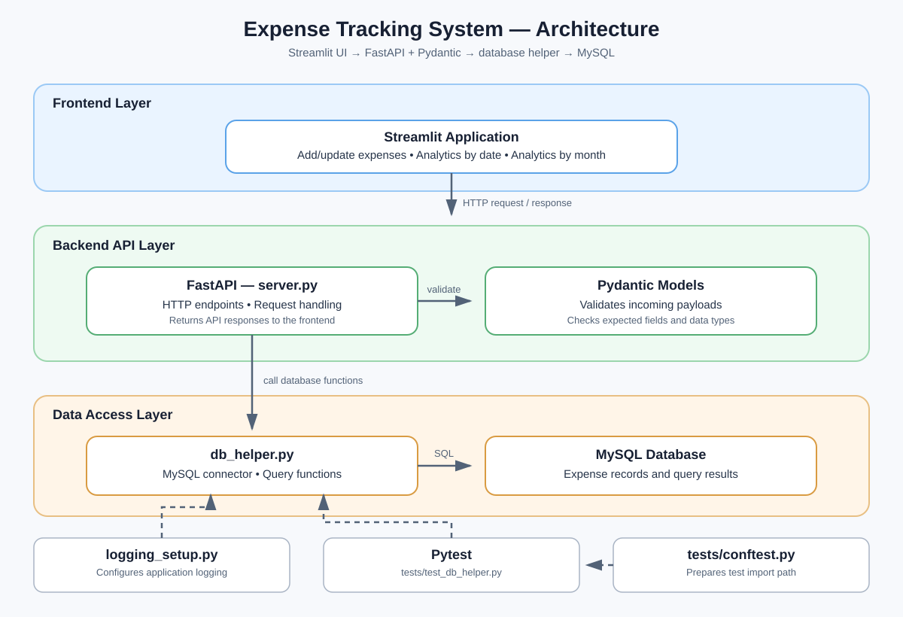
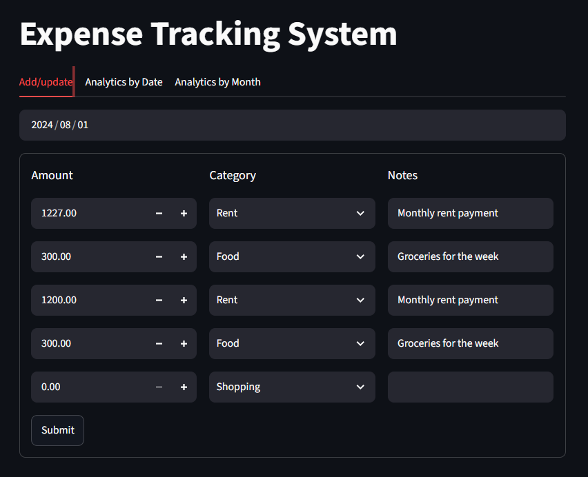
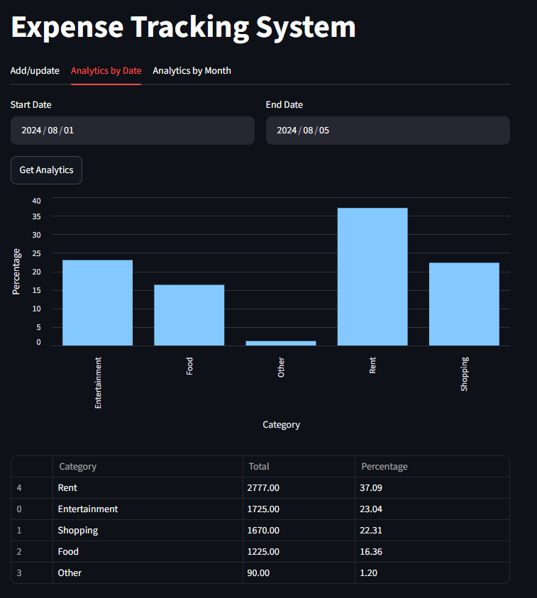
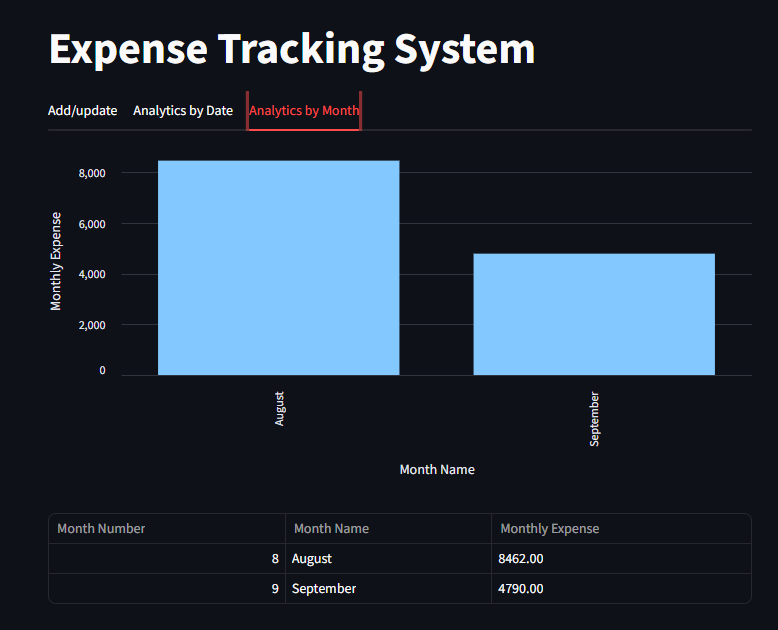

# Expense Tracking System

A full-stack expense tracking application built with **Python, MySQL, FastAPI, Pydantic, Pytest, and Streamlit**. It lets users record and update expenses, review spending over a selected date range, and understand monthly spending patterns.

The application separates database operations, API validation and delivery, and the user interface into distinct layers. This keeps database logic reusable and testable while allowing the Streamlit frontend to communicate with the backend through HTTP API requests.

## Table of Contents

- [Features](#features)
- [Application Architecture](#application-architecture)
- [How a Request Flows Through the Application](#how-a-request-flows-through-the-application)
- [Technology Stack](#technology-stack)
- [Project Structure](#project-structure)
- [Prerequisites](#prerequisites)
- [Setup and Configuration](#setup-and-configuration)
- [Run the Application](#run-the-application)
- [Run the Tests](#run-the-tests)
- [Application Screens](#application-screens)
- [Design Notes](#design-notes)
- [Possible Future Enhancements](#possible-future-enhancements)

## Features

### 1. Add or update expenses
- Select the date for the expenses.
- Enter an amount, choose a category, and add notes.
- Submit expense entries through the frontend to the backend API.

### 2. Expense analytics by date range
- Select a start date and an end date.
- Fetch an expense summary for that period.
- View category-wise totals and percentages in a chart and a table.

### 3. Monthly expense summary
- View monthly expense totals.
- Compare spending across months using a chart and a tabular summary.

### 4. Backend and reliability
- Store expense data in MySQL.
- Keep database operations in `db_helper.py`.
- Validate incoming request payloads with Pydantic models.
- Expose backend functionality through FastAPI endpoints.
- Record database-related activity using Python logging.
- Test selected database helper functions with Pytest.

## Application Architecture

The architecture diagram below shows the main components and the direction of data flow.



### Component responsibilities

| Component | Responsibility |
|---|---|
| **Streamlit frontend** | Collects user input, calls API endpoints, and renders responses as charts and tables. |
| **FastAPI (`server.py`)** | Defines HTTP endpoints and coordinates request handling. |
| **Pydantic** | Validates the structure and types of incoming request payloads before endpoint logic processes them. |
| **Database helper (`db_helper.py`)** | Uses the MySQL connector to execute database operations and returns results to the application, including lists of dictionaries where appropriate. |
| **MySQL database** | Persists expense records and provides the data used by the application. |
| **Logging setup (`logging_setup.py`)** | Configures logging used to record database-related activity. |
| **Pytest** | Tests selected database helper functions. `tests/conftest.py` configures the test environment so the tests can import the project modules. |
| **`requirements.txt`** | Lists the Python packages required to run the application and tests. |

## How a Request Flows Through the Application

For an analytics request, the flow is:

1. The user selects a date range in Streamlit and clicks **Get Analytics**.
2. The frontend sends the request payload to a FastAPI endpoint using an HTTP request.
3. Pydantic validates the payload against the endpoint's expected schema.
4. The endpoint calls the relevant function in `db_helper.py`.
5. The database helper uses the MySQL connector to query the database.
6. The query result is returned to the API layer.
7. FastAPI serializes the response and sends it back to the frontend.
8. Streamlit reads the response and displays the result as a chart and/or table.

The add/update flow follows the same general pattern, except the request carries expense data and the database operation creates or updates records.

## Technology Stack

| Technology | Purpose |
|---|---|
| Python | Application and database-access logic |
| MySQL | Relational database for expense records |
| `mysql-connector-python` | Python-to-MySQL connectivity |
| FastAPI | Backend API and endpoint definitions |
| Pydantic | Request payload validation |
| Streamlit | Interactive frontend |
| Requests | HTTP calls from the frontend to the backend |
| Pytest | Automated tests for selected database helper functions |
| Python `logging` | Application/database activity logging |

## Project Structure

The structure below reflects the modules described for this project. If your local repository nests a module inside a folder, keep the import path and run command aligned with that actual location.

```text
project-expense-tracking/
│
├── frontend/
│   ├── app.py                      # Main Streamlit application
│   ├── add_update_ui.py             # Add/update expense UI functions
│   ├── analytics_by_date_ui.py      # Date-range analytics functions
│   └── anylytics_by_month_ui.py     # Monthly analytics functions
│
├── backend/
│   ├── db_helper.py                 # MySQL operations and query functions
│   ├── server.py                    # FastAPI application and API endpoints
│   ├── logging_setup.py              # Logging configuration
│   └── server.log                   # Generated at runtime; excluded from Git
│
├── database/
│   └── expense_db_creation.sql      # MySQL database export
│
├── tests/
│   ├── backend/
│   │   └── test_db_helper.py         # Test cases for database helper functions
│   └── conftest.py                   # Configures the test environment and Python import paths
│
├── assets/
│   ├── architecture.svg              # Application architecture diagram
│   ├── add-update.png                # Add/update expense screenshot
│   ├── analytics-by-date.png         # Date-range analytics screenshot
│   └── analytics-by-month.png        # Monthly analytics screenshot
│
├── requirements.txt                  # Python dependencies
├── .gitignore                        # Files excluded from Git
└── README.md                         # Project documentation
```

## Prerequisites

Before running the project, make sure you have:

- Python installed.
- MySQL installed and running.
- The project database available as a SQL file or an already-created database.
- The database connection details needed by `db_helper.py`.
- A terminal opened at the project root.


## Setup and Configuration

### 1. Get the project

If the project is hosted in a Git repository:

```bash
git clone <your-repository-url>
cd project-expense-tracking
```

If you already have the project files locally, open a terminal in the project root instead.

### 2. Create and activate a virtual environment

Create the environment:

```bash
python -m venv .venv
```

Activate it in **Windows Command Prompt**:

```bat
.venv\Scripts\activate.bat
```

Activate it in **Windows PowerShell**:

```powershell
.\.venv\Scripts\Activate.ps1
```

If you use Git Bash, the activation command is generally:

```bash
source .venv/Scripts/activate
```

### 3. Install dependencies

```bash
python -m pip install -r requirements.txt
```

### 4. Prepare the MySQL database

1. Start your MySQL server.
2. Import the supplied SQL database file if the database has not already been created.
3. Confirm the database and tables are present.
4. Configure the connection details used by `db_helper.py` to match your local MySQL setup.

**Keep credentials out of source control.** If you move credentials to environment variables or a local configuration file, do not commit secrets to the repository.

## Run the Application

Run the backend and frontend in **two separate terminals**. Activate the same virtual environment in both terminals.

### Terminal 1 — Start FastAPI

Go to backend directory which contains `server.py` containing the FastAPI instance named `app` and execute:

```bash
uvicorn server:app --reload
```

FastAPI's interactive API documentation is typically available at:

- `http://127.0.0.1:8000/docs`

These documentation routes are provided by FastAPI when enabled by the application.

### Terminal 2 — Start Streamlit

Go to frontend directory which contains `app.py` and execute

```bash
streamlit run .\app.py
```

Streamlit will print the local address for the application in the terminal; open that address in your browser.


## Run the Tests

From the project root, with the virtual environment activated:

```bash
python -m pytest
```

To run only the database helper tests:

```bash
python -m pytest tests/test_db_helper.py
```

`tests/conftest.py` prepares the test import path so the tests can import the project modules. The tests in `tests/test_db_helper.py` assert the behaviour of selected database helper functions.


## Application Screens

### Add/update expenses

The first tab lets a user choose a date and add or update expense entries with an amount, category, and notes.



### Analytics by date

The second tab accepts a start date and end date, then displays a category-level expense summary with totals and percentage contribution.



### Analytics by month

The third tab presents monthly expense totals in a chart and table so that spending can be compared across months.




## Design Notes

- **Separation of concerns:** Streamlit handles presentation, FastAPI handles HTTP requests, and `db_helper.py` handles database access.
- **Payload validation:** Pydantic models help reject invalid request shapes before endpoint logic uses the payload.
- **Testability:** Keeping database functions in a helper module makes it possible to test them independently of the UI.
- **Observability:** Logging provides a way to inspect database-related activity when troubleshooting.
- **API boundary:** The frontend communicates with the backend through HTTP requests instead of directly querying MySQL.

## Possible Future Enhancements

These are ideas for future iterations, not claims about functionality already implemented:

- Add explicit configuration through environment variables and provide a safe `.env.example`.
- Add API-level tests for request validation, response codes, and endpoint behaviour.
- Add input constraints for positive amounts and valid date ranges.
- Add clearer handling for database connection failures and API errors in the frontend.
- Add pagination or filtering if the expense history grows substantially.
- Add authentication and user-specific expense records if the application is extended for multiple users.
- Add a reproducible database setup script or documented schema migration process.